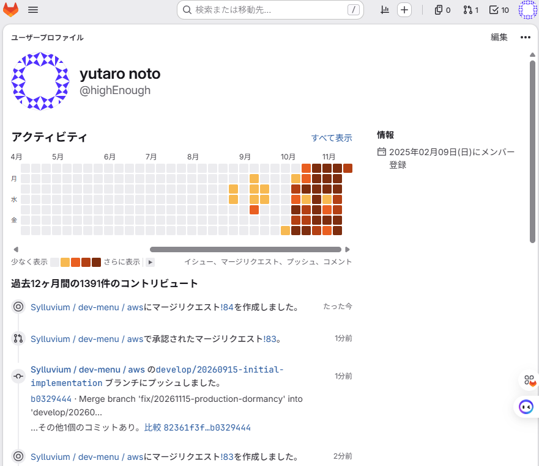

# DevMenu

> [!NOTE]
> 本Repositoryは、DevMenu Project全体と関連する公開成果物を案内するポートフォリオ用の入口です。各Repositoryは公開用Snapshotであり、Security、Environment固有情報、運用記録、作業履歴、Credentialその他の一部内容を公開対象から除外またはExample値へ置換しています。

## Overview

DevMenuは、学びたい技術、難易度、使える時間および目的を指定すると、個人開発やPoCで取り組める実装課題を3件提案するWeb Applicationです。

「試したい技術はあるが、具体的に何を作れば学習や検証につながるか決めにくい」という状態から、実際に取り組める課題へ進めることを目的としています。生成された提案と入力条件は共有履歴へ保存され、利用者は保存済みの技術名から過去の提案を再発見できます。

### Main Experience

1. 学びたい技術、難易度、所要時間、目的および任意の意向を入力する。
2. Amazon Bedrockを利用して生成された3件の実装課題を比較する。
3. 入力条件と成立した提案を共有履歴へ保存する。
4. 技術名を起点に過去の提案を一覧・詳細画面から再発見する。

Initial Implementationでは、要求定義、機能・Architecture・詳細設計、Infrastructure、Database、Backend、Frontend、Integration Test、Production ReleaseおよびProduction Verificationまでを一つのTrainとして実施しました。

## System Architecture

DevMenuは、ReactによるSingle Page Application、Jakarta EEによるModular Monolith Backend、Amazon Bedrock、RDS for MySQLで構成されています。ApplicationはAmazon EKS on Fargateで実行し、AWS InfrastructureはTerraform / Terragrunt、Application DeploymentはKubernetes / Kustomize、DeliveryはGitLab CI/CDを中心に管理します。

## Public Repositories

| Name | Overview | Main Contents / Technology Stack | Link |
| --- | --- | --- | --- |
| DevMenu Documentation | Product RequirementからArchitecture、API、UI、Tableまでを管理する公開設計Snapshot | Product Requirements、Function Design、System / Infrastructure Architecture、API / UI / Table Specification、Draw.io | [dev-menu-docs-public](https://github.com/pacific2409/dev-menu-docs-public) |
| AWS Infrastructure | DevMenuのAWS Infrastructure、Environment、Identity、DeliveryおよびLifecycleを管理するModule | Terraform、Terragrunt、AWS / Helm / Kubernetes Provider、VPC、EKS / Fargate、RDS、ECR、Route 53、ACM、WAF、CloudWatch、CloudTrail、Secrets Manager、Bedrock、GitLab CI/CD、Bash、Python | [dev-menu-aws-public](https://github.com/pacific2409/dev-menu-aws-public) |
| Database State Management | Environment別Schema、Account、GrantおよびTable DDLをVersion管理するDatabase Module | MySQL 8.4 LTS、SQL、SQLFluff、Amazon RDS for MySQL、AWS Secrets Manager、AWS Systems Manager Port Forwarding | [dev-menu-database-state-management-public](https://github.com/pacific2409/dev-menu-database-state-management-public) |
| Proposal Service | 課題提案、Amazon Bedrock連携、共有履歴およびHealth Endpointを提供するBackend Module | Java 21、Maven、Jakarta EE 11、MicroProfile、Payara Micro 7、AWS SDK for Java 2、EclipseLink、MySQL Connector/J、Log4j 2、JUnit 5、Docker、Kubernetes / Kustomize、GitLab CI/CD | [dev-menu-proposal-service-public](https://github.com/pacific2409/dev-menu-proposal-service-public) |
| Web Frontend | 課題注文・提案結果・共有履歴を提供するBrowser向けSingle Page Application | Node.js 24、React 19、React Router 7、TypeScript 6、Vite 8、Vitest 5、Testing Library、Playwright 1.64、OpenAPI TypeScript、Nginx、Docker、Kubernetes / Kustomize、GitLab CI/CD | [dev-menu-web-public](https://github.com/pacific2409/dev-menu-web-public) |
| Codex Project Template | DevMenu開発で使用した、Codex Agentによる仕様策定・実装・Review・Release管理のProject基盤 | Codex、AGENTS.md、Flow / Work Skills、Manager / Executor責務分離、Steering、Review用Subagent（Document Reviewer / Spec Comparator）、Explorer Subagent、Dev Container | [project-template](https://github.com/pacific2409/project-template) |

## Development Approach

DevMenuでは、Codex Agentを単一の実装担当として扱うのではなく、ManagerとModule別Executorに責務を分離しました。要求・設計・担当間Contractを文書として確定し、それぞれ独立したContextとRepositoryで作業しています。

- **Docs-first**: Product Requirement、Function Design、System / Infrastructure Architecture、詳細仕様を実装前に定義する。
- **Responsibility separation**: Infrastructure、Database、Backend、Frontendを独立したModuleとして管理する。
- **Train-based delivery**: Requirement、Design、Development、Integration、Release、Production Verificationを一つの変更単位として追跡する。
- **Explicit gates**: Development、Integration、Releaseの進行条件とユーザー承認を明示する。
- **Documented handoff**: Module間の依存事項、判断、Review、Handoffおよび検証結果を文書で受け渡す。
- **Immutable promotion**: Integrationで検証したArtifactを再BuildせずProductionへ昇格する。
- **Sanitized evidence**: Credential、Response Body、Raw Log等を残さず、検証結果と判定を追跡可能にする。

この進め方の基盤は、公開Repositoryの[project-template](https://github.com/pacific2409/project-template)にまとめています。

## Development Platform

実際の開発とCI/CDは、基本的に[GitLab.com / highEnough](https://gitlab.com/highEnough)上のRepositoryとPipelineで実施しました。

GitHub上のDevMenu各Repositoryは、完成した成果物をポートフォリオとして参照できるように作成した公開用Snapshotです。実EnvironmentのCredential、識別値、内部Runbook、Evidence、Handover、作業履歴およびGit履歴は公開対象に含めていません。

## Publication and License

- 公開Repositoryだけで実Environmentを再現・運用できることは保証しません。
- Example値を実値へ置き換えるだけで、安全なDeploymentが成立することは保証しません。
- 公開SnapshotにはLicenseを付与していません。著作権法上認められる範囲を超える利用、複製または再配布の許諾を意味しません。

## References
### About Coding Agent
| Title | Notes |
| --- | --- |
| [実践Claude Code入門―現場で活用するためのAIコーディングの思考法](https://www.amazon.co.jp/dp/B0G4NVX1NF?ref=ppx_yo2ov_dt_b_fed_digi_asin_title_351) | まさに虎の巻でした。本書や添付のサンプルを熟読し、こちらを自分なりに拡張する形で今回の開発基盤を構成しました。 |
| [ストーリーで覚えるCodex CLI入門: AIコーディングエージェントとの協働開発入門 物語で覚える開発入門](https://www.amazon.co.jp/gp/product/B0DR9WRCNJ/ref=ku_mi_rw_edp_ku) | こちらの内容などからClaude CodeとCodexの仕様の差を補完しました。 |

### About Generative API
| Title | Notes |
| --- | --- |
| [全容解説GPT テキスト生成AIプロダクト構築への第一歩](https://www.amazon.co.jp/dp/B0CPSQK4J1?ref=ppx_yo2ov_dt_b_fed_digi_asin_title_351) | GPTという概念について解像度が上がりました。 |
| [ChatGPT API×Pythonで始める対話型AI実装入門](https://www.amazon.co.jp/gp/product/B0CLKS7QHV/ref=ku_mi_rw_edp_ku) | GPTのパラメータやAPIの用法について理解できました。 |
| [PythonとAI　AI英会話練習アプリを自作する完全ガイド](https://www.amazon.co.jp/dp/B0H92H6W3H?ref=ppx_yo2ov_dt_b_fed_digi_asin_title_351) | プロダクトのアイデアが素晴らしく、どのようにコントロールできる形で生成AIアプリケーションに落とし込んでいくかという点非常に参考になり、DevMenuのアイデアもこちらから大いにインスピレーションをいただいています。 |
| [Amazon Bedrock 生成AIアプリ開発入門](https://www.amazon.co.jp/dp/B0CY28Z13G?ref=ppx_yo2ov_dt_b_fed_digi_asin_title_351) | AWSとの連携についてはこちらからイメージをつけました。また今後はシリーズの他の書籍に触れRagやAgentCoreにも挑戦していきたいです。 |
| [LLMの原理、RAG・エージェント開発から読み解く　コンテキストエンジニアリング](https://www.amazon.co.jp/dp/B0GH75V1JL?ref=ppx_yo2ov_dt_b_fed_digi_asin_title_351) | LLMの根本の仕組みから用法へと展開する重厚な内容で、LLMに向き合う姿勢についてのコンパスとして捉えております。 |

### AWS
| Title | Notes |
| --- | --- |
| [図解 Amazon Web Servicesの仕組みとサービスがたった1日でよくわかる](https://www.amazon.co.jp/dp/B09MQ14XR1) | AWSの導入や各サービスの概要を掴むにはこれ以外ないと思えるほど読みやすく、かつ、費用面も記載があるので、勉強になりました。 |
| [AWSネットワーク入門 第2版 impress top gearシリーズ](https://www.amazon.co.jp/gp/product/B0BH7VT8P7/ref=ku_mi_rw_edp_ku) | 非常に読みやすく、AWSについてどういった経路をたどってリクエストが届くのかという構造的なイメージが掴めました。 |
| [SpringBootで学ぶAWS開発入門: 後悔しないための入門書：基礎から学べるAWS開発](https://www.amazon.co.jp/gp/product/B0BFPS3WKG/ref=ku_mi_rw_edp_ku) | AWS環境の中でどうアプリケーションが動くのか、そのためにどう実装するのかについて非常に実践的に記載されており、解像度が大いに上がりました。 |
| [AWSコンテナ設計・構築［本格］入門](https://www.amazon.co.jp/dp/B09DKZC1ZH) | AWSにおける運用も見越したコンテナの実践的な設計観点について大変勉強になりました。パイプラインにはこちらで得た知見を取り入れています。 | 
| [Kubernetes on AWS～アプリケーションエンジニア 本番環境へ備える](https://www.amazon.co.jp/dp/B087PTX51W) | EKSの構築や操作・運用について網羅的に確認しました。 |

### IaC(Terraform)
| Title | Notes |
| --- | --- |
| [実践Terraform　AWSにおけるシステム設計とベストプラクティス](https://www.amazon.co.jp/dp/B07XT7LJLC) | 情報量や網羅性も読みやすさも非常に良く、体系的に学べ、レファレンスとしても活用しました。 |
| [TerraformでFargateを構築してGitHub Actionsでデプロイ！Laravel編](https://www.amazon.co.jp/dp/B09GFB67X1) | こちらはより実践やハンズオンの特長が強く、すばやくイメージを掴みやすい内容でした。Fargateについて特に参考にしました。 |
| [AWSとTerraformで学ぶプロダクションレディなKubernetes](https://www.amazon.co.jp/dp/B08ZBZCMX7) | こちらはEKSについてAWSの公開モジュールを使う手法で非常に実践的な記述があり、大いに参考にしました。 |
| [Terragrunt徹底活用ガイド](https://www.amazon.co.jp/dp/B0F9WP48WG) | コンパクトに文法やterraformの何を解決するのかが記載されており、わかりやすい内容でした。 |

### Other(Git/Container/Orchestration/Pipeline)
下記いずれも開発開始時点で既読ではありましたが、各分野の参考書として都度見返しております。

| Title |
| --- |
| [Pro Git](https://progit-ja.github.io/#download) |
| [仕組みと使い方がわかる Docker＆Kubernetesのきほんのきほん](https://www.amazon.co.jp/dp/B08T961HKP) |
| [Kubernetes完全ガイド 第2版 impress top gearシリーズ](https://www.amazon.co.jp/dp/B08FZX8PYW) |
| [Kubernetesマイクロサービス開発の実践 impress top gearシリーズ](https://www.amazon.co.jp/dp/B0CPLR674N) |
| [実践Helm─自作アプリをKubernetesクラスタに簡単デプロイ！](https://www.amazon.co.jp/dp/B07TQT6SVY) |
| [GitLab実践ガイド impress top gearシリーズ](https://www.amazon.co.jp/dp/B079DL362C) |

